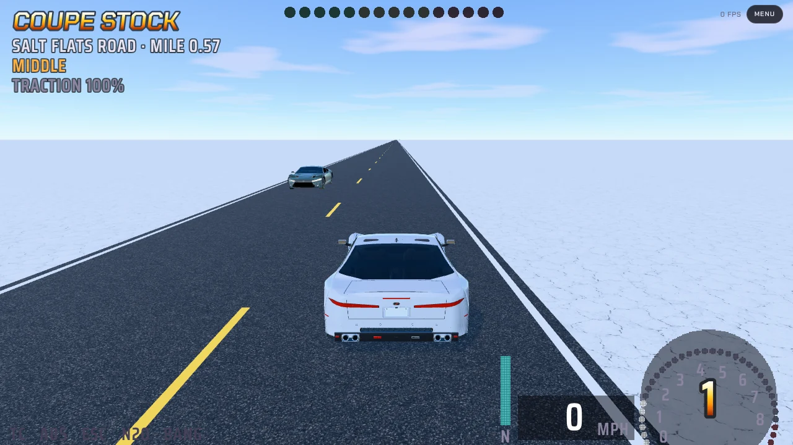
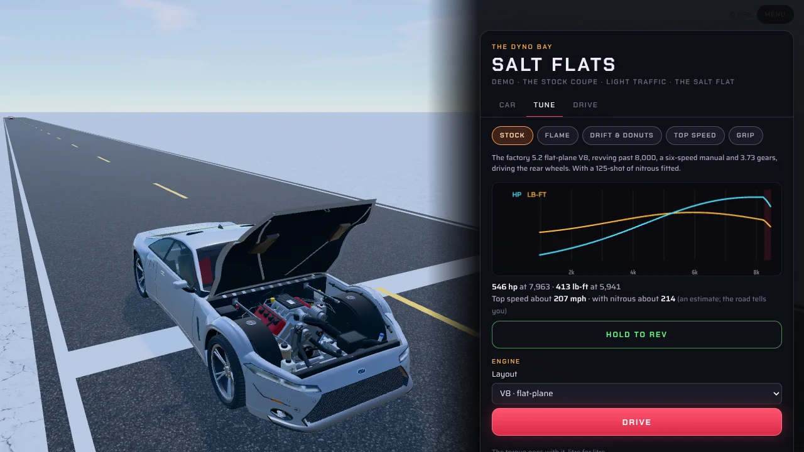
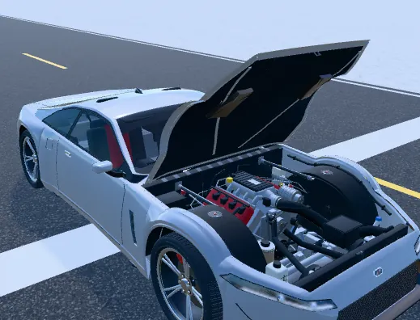
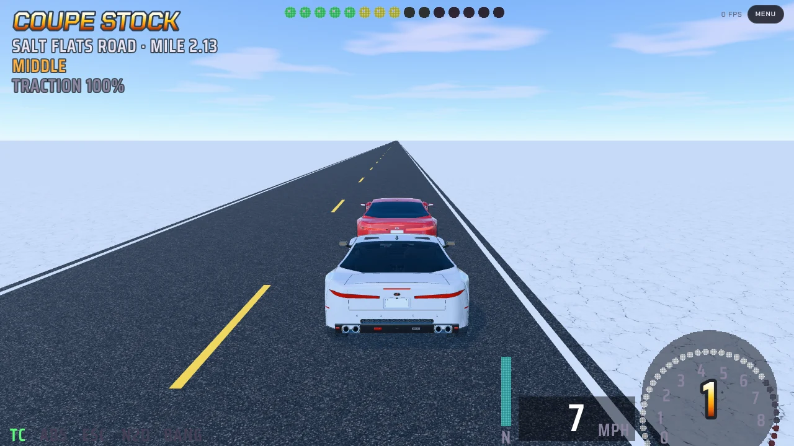
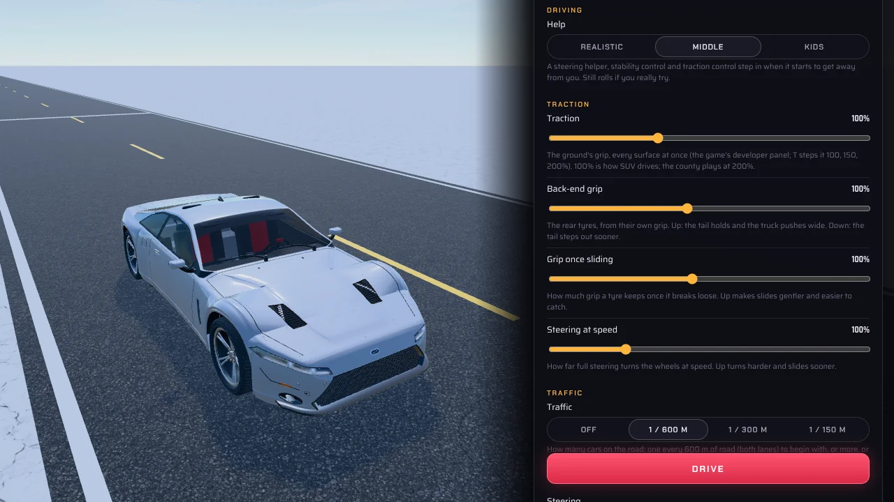

# Redline County: Salt Flats (the demo)

**Salt Flats** (this folder, the page `salt-flats.html`) is the first cut of the game: Salt Mini's salt flat and its
ten-mile road, driven on the game's own physics, with every piece the game will have, for the stock Coupe only. More
cars and more of everything come in from here.

Open `salt-flats.html` in Edge or Chrome on the laptop (one self-contained page, about 5 MB). `sh build.sh` rebuilds
it (run `npm ci` in this folder once first).

## What's in it

- **Your car on the road: the Coupe's Studio 2 Drive** (644,600 triangles, 96 draws). Studio 2 with its own engine
  bay left out and the game's small one in its place; the cabin (it shows through the windows) and the whole
  underside (cars roll) are kept.
- **The dyno bay** (Esc, P or the Menu button): the car stops where it stands and becomes the **full Studio 2**
  (707,820 triangles, 107 draws), built the first time the bay opens. The bonnet lifts on its hinge. **Hold to rev**:
  the engine shudders on its mounts at idle and rocks over against the torque as it revs, and the back wheels turn
  with the engine as on a dyno's rollers (in fourth gear: the Coupe drives its back wheels). The Tune sheet, the dyno
  chart and the presets are beside it, as in Salt Mini. **Drive** takes you back out in the Studio 2 Drive.
- **Traffic: the 5k Coupe with the Studio 2 surface baked on** (4,976 triangles a car, its pictures 512 x 768,
  6 MB for every car together). **One car every 600 m** to begin with: 55 cars along the road, both lanes. The
  Drive tab's **Traffic** row sets it: off, or one every 600, 300 or 150 m.
  - Each car keeps its lane: out along the right-hand side of the yellow line, round at the far end, back along the
    other side. It wants about 60 mph (a little more or less, by the driver), slows for the turns at the ends,
    and keeps a gap to the car ahead and to you when you're in its lane (the game's own car-following rule, as Road
    Not Found's traffic drives).
  - It's solid: you can't drive through a car. A car you hit stops, and moves on once you're clear of it.
  - Its head and tail lamps are lit; each car has a paint of its own (the game's traffic colours).
  - All the traffic is drawn together: each part of the car (the body, the lamps, the glass, the underside, the
    wheels, the shadow) one draw for every car at once, so it's **8 draws however many cars there are**. Only the
    cars within 2.5 km are drawn.
- **Everything else is Salt Mini as the Flame Test has it:** the HUD, the keys and touch controls, the cameras (Chase,
  Far, Hood, Cinematic), the Digital Engine's sound, the presets (it starts on **Stock**: the factory 5.2 V8 with a
  125-shot of nitrous), the flames and the salt dust. It keeps its own save (`sf-`), so it never touches Salt Mini's.

## The keys

<kbd>W</kbd> <kbd>↑</kbd> gas · <kbd>S</kbd> <kbd>↓</kbd> brake and reverse · <kbd>A</kbd> <kbd>D</kbd> steer ·
<kbd>Space</kbd> e-brake · <kbd>E</kbd> <kbd>Q</kbd> shift · <kbd>N</kbd> nitrous · <kbd>C</kbd> camera ·
<kbd>R</kbd> back to the start · <kbd>F</kbd> the numbers (frame rate, triangles, draws, the traffic drawn) ·
<kbd>Esc</kbd> <kbd>P</kbd> the dyno bay.

## What it costs

Measured in the test browser (a computer with no graphics card, so only the counts mean anything; the F readout on
the laptop gives its real frame rate):

| | Triangles | Draws |
|---|---|---|
| Your car on the road (Studio 2 Drive) | 644,600 | 96 |
| Your car in the dyno bay (Studio 2) | 707,820 | 107 |
| One traffic car | 4,976 | (shared) |
| All the traffic | 4,976 a car drawn | 8 |
| The whole road scene a frame, the shadows in (your car, 9 traffic cars in reach) | 2,080,934 | 403 |

## Where it comes from

- `src/drive/`: Salt Mini's physics and engine (Salt Mini Flame Test's copy), byte for byte but for the save keys.
- `src/ui/`: Salt Mini's HUD and sound. `src/flats/`: its page (`main.js`), materials, Tune sheet, flames and dust,
  with the demo's changes in `main.js`, and the traffic (`traffic.js`, new).
- The cars' builders and models come straight from `../models/src` (nothing copied), so the demo always has the
  models as they are. The traffic Coupe's data is `../models/coupe-traffic/data/coupe_t5000_s2.js`.
- `tools/shot.js <out-dir> 'name=code' ...`: pictures and numbers from the page (Salt Mini's tool).

