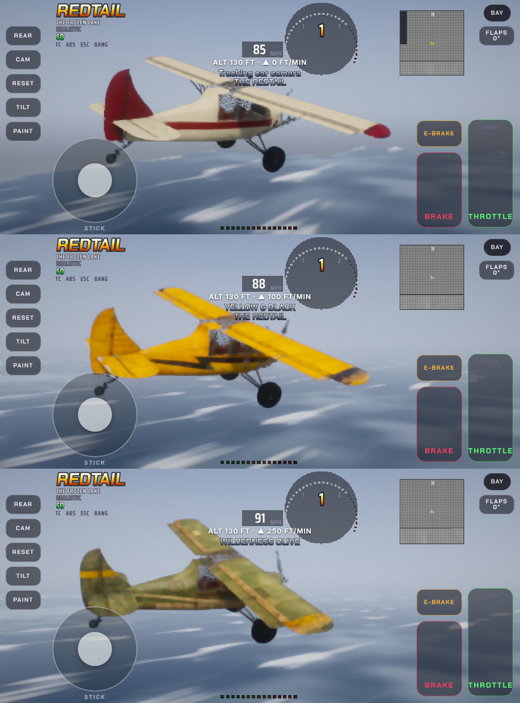

# The Redtail (the bush plane)

Christopher's bush plane for the racing game: a two-seat, high-wing taildragger. It's covered in fabric over a steel-tube frame, has tundra tires, and has a flat engine under a round cowl. It's 7.0 m long, has a 10.6 m wingspan, and sits about 6.4 degrees nose up on its wheels. **The name Redtail stays with the racing game** (Salt & Sand, Ice & Snow, with the plane added). The story game, *Beyond the Last Road*, uses the same model under a new name (see `../beyond-the-last-road/`).

His rule: **every version of the model is kept as it was made and never overwritten.** A change to the model makes a new version.

## What's here

| Folder | What it holds |
| --- | --- |
| `redtail-versions.html` | One viewer with every version. The `v2 ⇄` chip (V, 1 or 2 on a keyboard) swaps the model in place. The **Paint** chip (P) changes redtail-2's paint. `#v1` at the end of the address opens on redtail-1. |
| `versions/redtail-1/` | The model built in code: 241,278 triangles. `redtail-1-model.js` is the game's mesh form (x forward, y up, z right, metres), with its own viewer and compare pictures. |
| `versions/redtail-2/` | **The one the games use.** redtail-1 baked in Blender onto a copy cut down to 55,653 triangles + 4,828 of glass, with the patina from his reference sheet. `redtail-2.glb` (4.1 MB), `redtail-2.blend`, its pictures (`albedo_ao.png` colour, `normal.png` surface detail, `orm.png` roughness/metal, `ao.png` shade), and `redtail-2-source-model.js` (redtail-1 with its nav lights coloured, which the bake was made from). |
| `versions/redtail-2/paint/` | His two paint jobs: `redtail-2-yellow-black` and `redtail-2-wilderness-olive` (2048, .webp for the games, .png to look at). `pictures/` has his ten ChatGPT pictures they were made from (five views each). |
| `ref/` | His reference pictures: two orthographic sheets, plus close-ups of the engine, cockpit, tail, gear, strut fittings and wing tip. |
| `paint-template/` | The five-view template sheet for asking ChatGPT for a new paint job, and its scales (`template.json`). |
| `builds/` | The plane in the games: `salt-and-sand-redtail-2-flying-paints.html` and `ice-and-snow-redtail-2-flying-paints.html` (9.5 MB each). |
| `game/` | The code that puts it in a game: `rt-game.js` (the plane as a game vehicle, its drawing, cockpit, lights, sound), `rt-fly.js` (lift, stall, drag, thrust, flaps, the stick, tilt, throttle, PAINT button, height readout), `rt_patch.py` (exact text swaps into the page), `glb2js.py`, the tests (`rt-run.py`, `rt-test.js`, `rt-fly-test.js`) and `build.sh`. |
| `tools/` | The viewers' source (`viewer*.js`, `make.sh`, `make-versions.sh`), the bake (`dump.js`, `patina.py`, `bake.py`, `export.py`, `post.py`), the paint fitter (`livery.py`), and the picture scripts (`shoot*.py`, `template.py`). |
| `docs/` | Compare sheets and in-game screenshots. |

## Rebuilding (from the repo's top folder)

- **The games:** `sh redtail/game/build.sh`. It turns redtail-2.glb into `redtail/game/rt2-data.js`, then patches `salt-and-sand/salt-and-sand.html` and `salt-and-sand/ice-and-snow.html` into `redtail/builds/`. Checked Nov 7 2026: both come out byte for byte the same as the builds here.
- **The viewer:** `cd redtail/tools && npm ci && cd ../..`, then `sh redtail/tools/make-versions.sh`. Also checked byte for byte.
- **A new paint job:** ask ChatGPT for five views (left, right, top, underside, front). Then run `python3 redtail/tools/livery.py <folder of the five pictures> <file prefix> <out.png>`. First it needs `node redtail/tools/dump.js`, which writes redtail-1's pieces into `redtail/work/bake/hi/` (make the folder first). It fits the model's outline to each picture, then paints each texel from the pictures that see it squarely. Views that fit under 0.6 are left out. Then add the paint to `RT_PAINTS` in `game/rt-game.js` and to `paints` in `game/rt_patch.py`.
- **The bake:** Blender as a Python module (`pip install bpy`): `dump.js` → `patina.py` → `bake.py` → `export.py` → `post.py`. Scratch files go in `redtail/work/` (not kept in git).
- **Tests:** `python3 redtail/game/rt-run.py file://$PWD/redtail/builds/<page>.html <tag> m|d <tests>` runs Playwright with headless Chrome (phone `m` or laptop `d`). The test browser has no graphics card, so only triangle counts, distances and speeds mean anything. Frame rates, tilt and the sound need his phone.

## How it works in the game (for whoever changes it)

- It's a game Vehicle on the game's own physics. The tailwheel steers, no wheel is driven (the prop pushes), and brakes are on the mains. `v.step` runs `rtStep`, which adds the aero and thrust forces, then the game's own step.
- Model frame: x forward, y up, z right, thrust line at y = 0. Physics frame: the model turned 6.38 degrees nose up.
- It's drawn as material 120 in the game's shader, which reads its three pictures on texture units 13 to 15. The sampler locations come from `gl.getUniformLocation`, because the renderer pre-assigns its units.
- Engine: 260 hp, voiced as a big flat six through the game's Digital Engine (`SIM.makeSpec`), plus a prop layer and a stall horn.
- Tested: tail up at about 35 mph; lift-off at 56 mph after 65 m with 20 degrees of flap; climbs about 2,800 ft/min; top speed 136 mph; stall about 38 mph clean.
- Keys: arrows are the stick, W/S the throttle (1 to 9, 0 for full), L flaps, U paint, Space brakes. Phone: STICK, TILT, FLAPS, THROTTLE lever, BRAKE, PAINT.

## Still to fix

- The HUD keeps the car's TC/ABS/ESC lights and a gear "1".
- The bay shows the car, not the plane.
- The chase camera stays level behind it instead of climbing and diving with it.
- redtail-2's paint has small blotches near the red wing tips, seen close up.
- Wilderness Olive's front view fitted too poorly, so the nose comes from the other views.
- His ears haven't checked the engine sound yet, and his phone hasn't tried the tilt steering.
