# Redline County: Salt Mini Flame Test

**Salt Mini Flame Test** (the folder `salt-mini-flames/`, the page `salt-mini-flames.html`): a copy of Salt Mini
(cargames, `salt-mini/` on the branch `suv-studio/hd-truck`) with four things added: **seventeen cars to drive** (the eight factory cars and nine more of the
game's builds), each as the game draws it or as its Studio model (Salt Mini Plus's models), and the Coupe also as its
second Studio version (Studio 2), **fire out of the tailpipe when you rev**, **five presets** in the bay (Stock,
Flame, Drift & donuts, Top speed, Grip), each found and checked by driving it on the page's physics, and **salt dust**
off the tyres (and tyre smoke off the blacktop). Everything else is Salt Mini as it was: the Studio SUV, the game's
physics, HUD, controls, cameras, the Digital Engine's sound and the Tune sheet. It has its own save (`smf-` keys), so
it never touches Salt Mini's.

Open `salt-mini-flames.html` in a browser with WebGL2 (one self-contained page, about 2.5 MB). `sh build.sh` rebuilds
it (run `npm ci` in this folder once first).

## The cars (the bay's Car tab)

Menu, then **Car**: three rows. The bodies (SUV, Pickup, Hatch, Wagon, EV, Trail, Coupe, Muscle, Wedge, Hyper); the
builds of the one picked, when it has more than one (the SUV's Stock, Sleeper, Rock & Mud and Race; the Hatch's
Group B; the Coupe's GT; the Wedge's Night Runner; the Hyper's Track); and its versions: **Game**, **Studio**, and
**Studio 2** where a car has one (so far the Coupe). Each car drives on its own build: the game's physics, engine,
gearbox, drive and sound for it, exactly as Road Not Found has them; low range and lockers where the car has them.
The Tune sheet, the presets and the flames follow the car (its own factory engine is what edits are measured from;
fire from its own tips: the Night Runner's six). Each car keeps its own tune; the Drive tab's settings are shared.
The car and the version are saved. The HUD names the build (SUV, SLEEPER, NIGHT RUNNER) and the preset.

- **Game**: the car exactly as Road Not Found + Traffic builds it.
- **Studio**: the same car modelled for a close look, from the models next door (`../models/src`), built in the
  page from its code the way the Studio SUV always was: so the page is about 3 MB, not the viewer's 24 MB. The baked
  versions aren't used.
- **Studio 2**: a second Studio version (the Coupe's: its underside built whole, the exhaust out to four tips in the
  valance, its own engine bay, the plate, the high stop lamp, badges, markers and seals; the cabin's tunnel taller).
  The SUV's and the other cars' can come in the same way.

Built in the test browser (a computer without a graphics card, so a phone or the laptop will differ; its build times
also vary from run to run, the Rock & Mud's from 6 to 13 seconds). Memory is the car's own shapes while it's being
drawn:

| Car | Studio: triangles, draws, memory, build | Studio 2 | Game: triangles, draws, memory |
|---|---|---|---|
| SUV | 484k, 78, 37 MB, 6.7 s |  | 52k, 48, 5 MB |
| SUV Sleeper | 603k, 99, 46 MB, 7.7 s |  | 52k, 51, 5 MB |
| SUV Rock & Mud | 528k, 99, 45 MB, 12.8 s |  | 61k, 50, 6 MB |
| SUV Race | 481k, 88, 40 MB, 6.8 s |  | 49k, 49, 5 MB |
| Pickup | 545k, 94, 41 MB, 9.5 s |  | 54k, 48, 5 MB |
| Hatch | 430k, 84, 31 MB, 8.3 s |  | 47k, 45, 4 MB |
| Hatch Group B | 455k, 87, 34 MB, 19.6 s |  | 53k, 50, 5 MB |
| Wagon | 532k, 83, 40 MB, 81 s |  | 52k, 45, 5 MB |
| EV | 498k, 88, 36 MB, 6.8 s |  | 55k, 48, 5 MB |
| Trail | 491k, 105, 30 MB, 2.8 s |  | 51k, 51, 4 MB |
| Coupe | 480k, 84, 34 MB, 4.3 s | 707k, 95, 59 MB, 5.9 s | 50k, 45, 5 MB |
| Coupe GT | 430k, 92, 35 MB, 5.6 s |  | 52k, 48, 5 MB |
| Muscle | 419k, 85, 31 MB, 4.3 s |  | 58k, 43, 5 MB |
| Wedge | 499k, 96, 37 MB, 9.4 s |  | 46k, 49, 4 MB |
| Wedge Night Runner | 534k, 99, 39 MB, 2 s |  | 49k, 53, 5 MB |
| Hyper | 602k, 99, 46 MB, 2.9 s |  | 50k, 49, 5 MB |
| Hyper Track | 537k, 102, 44 MB, 2.9 s |  | 49k, 50, 5 MB |

A Game car builds in a fraction of a second. Only the car being driven is kept: the last one is thrown away (its
memory given back) when another is built. The five builds without a Studio model yet (the Trail's Crawler, the
Wagon's Sleeper, the Pickup's Prerunner, the Muscle's Drag, the EV's Race) aren't in the list.

- **Draws**: the Studio car's parts are merged, one mesh a material (Salt Mini Plus's `mergedMeshes`).
- **The wheels**: each sits in a steering group holding its brake (the caliper and dust shield steer but don't roll)
  and the wheel (it rolls), placed where the physics has it. The Trail's spare is on its door.
- **The presets on other cars**: a preset's engine is made as the sheet would make it on that car, so a bigger
  engine keeps that car's own torque per litre (the Hatch's 1.8 turbo makes a lot per litre, so its Drift engine is
  about 710 hp where the SUV's is 545); the Drift, Grip and Top speed presets say V8 and (Drift, Grip) no boost, so
  they mean the same engine on every car. The numbers in the presets' notes were measured on the SUV. Every preset
  was run 20 seconds on every car: no errors, nothing rolled. The cars with more power from the factory than a preset
  gives (the Sleeper, the Rock & Mud, the Hyper) go faster on Stock.
- **The EV** runs on its electric motor, which the Tune sheet's engine doesn't describe, so only Stock is offered for
  it (the engine presets made nonsense of it: Top speed crawled to 63 mph).

### Where the cars' code comes from, and how it was checked

The Studio kit (`src/hd/`) and each car's detail (`src/cars/`) are the models' (`../models/src` on the main line at
ff2e84e, with the nine new builds), merged with the Coupe's Studio 2 from the viewer build it was sent in
(`salt-mini-plus-viewer_2.html`: its code isn't in the models yet). The two had grown apart from the copy this page
had (4e76f10): the main line added the widebody arches, the mid-engined front trunk and the race numbers' font; the
viewer added the second-version hooks (`KIT.setAlt`, `HD_CARS.coupe2`), the deeper arches and the cabin's tunnel.
Each shared file was merged three ways from that common copy; one line clashed (the arches' options, `opt` kept,
`opt.zi` added). The Studio 2 files are in `src/cars/coupe/` as `90_s2_kit`, `91_s2_under`, `92_s2_bay`,
`93_s2_bits` and `99_s2` (named here so they load after the Coupe's own). Checked by building every car and comparing
every part's arrays (positions, colours, materials; `tools/hashpage.js`):

- the eight cars that were here, Studio and Game: **identical** to before;
- the nine new builds: **identical** to the models' own viewer at ff2e84e;
- the Coupe's Studio 2: **identical** to the viewer it came in (589k triangles of parts, 707k drawn with the four
  wheels).

`src/game/23_parts.js` (a car builder, not physics) has the models' Studio 2 hook in it; the game's own cars build
exactly as before. `tools/sync_models.sh` refuses to run until the models have the Studio 2 code themselves, so it
can't take the Coupe's Studio 2 away.

## Where the fire comes from

The flames come from how the engine is built, the way they do on a real car: unburnt fuel reaching a hot, open
pipe and lighting there. The page works out how ready the engine is to throw fire (0 to 1) from the Tune sheet: how
open the exhaust is (a muffler and a cat cool and catch it; a straight pipe lets it out at the tip), times how much
unburnt fuel reaches it (the pops and crackle, the cam, the anti-lag). The stock truck comes out at 0.05: no fire to
speak of. The Flame tune is 1.

When it throws fire:

- **Lifting off high in the revs** (in the bay: letting go of HOLD TO REV): a burst, then crackle for a moment.
- **The rev limiter**: every cut lights what's in the pipe (a hard cut much more than a soft one).
- **The two-step**: brake and gas together at a stop holds the engine at the launch revs on its cut, spitting fire.
- **The anti-lag, off the throttle**: it burns fuel in the hot side on purpose, so the pipe keeps spitting while you
  coast; at idle only now and then, like a rally car sitting with its anti-lag on.
- **A shift up under power**, and **a blip** (the revs climbing fast high up).
- **A bang in the sound** (the Digital Engine's pops) throws one of its own.

## The Flame tune (the Flame preset)

Menu, then **Flame** in the presets row at the top of the Tune tab. The page starts on it. It fits:

| Part | Setting | Why it makes fire |
|---|---|---|
| Induction | Turbo, large, 1.4 bar | A big turbo is what needs anti-lag |
| Anti-lag | On | Keeps the turbo lit off the throttle by burning fuel in the exhaust side |
| Exhaust | Straight pipe | No cat, no muffler: nothing to cool the fire or catch it before the tip |
| Camshaft | Race | Its overlap pushes unburnt mixture into the pipe |
| Pops and crackle | 100% | The overrun fuel: fire every time you lift |
| Rev limiter | Hard cut | Each cut sends unburnt mixture into the pipe |
| Launch control | On, 4,500 rpm | The two-step: fire while you hold it at the line |
| Redline | 6,800 rpm | Room to rev a built engine |
| Intake | Ram air | Air for the boost |
| Nitrous | 125 shot | Kept from Salt Mini |

That's 633 hp at 6,770 rpm and 560 lb-ft at 4,764 on the dyno, about 180 mph. **Stock** puts the factory engine back
(and the fire goes away).

## The presets

One row of chips at the top of the bay's Tune tab. Each is a whole setup: the engine (the Tune sheet's own keys, made
as the sheet makes them: a bigger engine keeps its torque per litre), the final drive and the Plus tune, and the Drive
tab's driving level (Help), traction and handling. The chip of the one fitted is lit, with a few lines under it saying
what it is; change anything by hand and none is lit. The HUD says which (SUV STOCK, FLAME, DRIFT, TOP SPEED, GRIP).

| Preset | Engine | Gears, Plus | Help, traction, handling |
|---|---|---|---|
| Stock | the factory 4.6 V8, 125-shot | 3.73 | Middle, 100%, all 100% |
| Flame | the Flame tune above | 3.73 | Middle, 100%, all 100% |
| Drift & donuts | 7.4 big-block, race cam, straight pipe, hard cut | 4.10 | **Real** (no helpers), 100%, back-end grip 80%, grip once sliding 115%, steering at speed 140% |
| Top speed | 9 L turbo, 3.5 bar, 10,700 rpm, 250-shot | 1.80, **Plus × 6** | Middle, **200%**, all 100% |
| Grip | 6.2 V8, street cam, no boost | 4.88 | Middle (traction control), **200%**, back-end grip 125%, grip once sliding 125% |

What each does, driven on the page's physics (`tools/eval.js`, the numbers below):

| Preset | Top speed, measured (bay's estimate) | 0 to 60 | Tyre slip, floored from a stop on the salt | Donut (full lock, floored, from a stop) |
|---|---|---|---|---|
| Stock | 132.7 mph (134) | 9.5 s | 2.9% | 13° of slide, turning 43°/s: the helpers catch it |
| Flame | 177.6 mph (180) | 6.5 s | 4.6% | 12°, 43°/s |
| Drift & donuts | 167.4 mph (167) | 6.6 s | 27% | **66° of slide, turning 165°/s** (a full turn every 2.2 s), never tipping |
| Top speed | **513.7 mph** (519), at mile 9.5, 79 s | 3.7 s | 18% | 9°, 38°/s |
| Grip | 151.7 mph (153) | 7.9 s (5.9 with the engine already running) | **1.5%**, never past 10% | 16°, 57°/s |

(0 to 60 here starts with the engine being started.)

- **Drift & donuts, holding a drift**: a test driver who countersteers by how far the tail is out (steer = 0.3 − 1.2 ×
  the slide) holds a **33° drift at 55 mph for eight seconds, 100% of the time between 15° and 60°**, without spinning.
  The stock truck with the same driver slides 1°. With the steering held still it spins, as any drift car would.
- **Top speed, the ceiling**: with the Plus tune taken past the game's own × 2, the truck tops out at **513.7 mph with
  the traction at 200%** whatever the power or the gearing (Plus × 5 to × 36, final drive 1.5 to 2.5 all stop there):
  past that the tyres can't push it any harder against the air. At 100% traction the tyres stop it at about 375 mph.
  Inside the game's own limits (every slider at its end, Plus × 2: about 6,600 hp) it's about 388 mph at 200% traction, 376 at 100%. It runs dead straight and level
  the whole way. The Plus slider now goes to × 12 (up to × 2 is the game's own).
- **Grip**: a tyre always slips a little to grip (about 1% is a tyre holding hard). Short gears alone make the tyres
  spin *more* (more push at the wheel), so the Grip preset pairs off-road gears with traction control, the ground at
  200% (as the county plays) and more grip at both ends.

## The dust (`src/mini/dust.js`)

- **Salt dust**: the game's own rule (Road Not Found + Traffic, `53_fx`): each tyre on the salt throws dust by how
  fast it spins against the ground (past 1.5 m/s) and a little by how fast it rolls (past 4 m/s); the puffs drift
  back and up, slow in the air, grow to five times their size and fade over about two seconds. Added for the salt
  flats: a tyre **sliding sideways** (a drift, a donut) throws dust the same as one spinning, and a new puff starts
  with most of the truck's own speed (the wake drags it along before the air lets it go), so at speed the dust
  streams back from the tyres instead of hanging where the truck was a moment ago. Bigger puffs the faster it goes.
- **Tyre smoke**: a tyre spinning hard on the blacktop (a burnout: brake and gas together with no launch control)
  throws white smoke.
- **The budget**: at most 360 puffs alive (220 on a phone), all in **one draw** (2 triangles a puff). When it's full,
  new ones aren't made. Measured: a donut on the salt keeps about 80 alive; a run at 300 mph fills it.

## How the fire is drawn (`src/mini/flames.js`)

At each tip the game's builder lists (its `D.tips`: where the outlet is, which way it points, how big it is; the stock
truck has one, at the back on the right):

- **The outer flame**: a teardrop of fire along the pipe's line, soft at its edges, broken into licking tongues by a
  noise that runs out along it, pale yellow at the root through orange to red at the ends. It covers a little of what's
  behind it as well as adding its light, so it stays orange in front of the bright sky instead of adding up to white.
- **The core**: a smaller, hotter blue-white cone right at the outlet.
- **The glow**: a soft orange halo round the outlet.
- **One orange light** at the tips lights the bumper and the ground under them while there's fire. It's made with the
  page, so the materials are built with it from the first frame (adding a light later would rebuild them all).
- Slow, the hot gas lifts a little; fast, the air lays it back behind the truck and stretches it.

## What it costs

While there's fire: **3 more draws and about 1,900 more triangles** (the scene is about 393 draws and 1.49 million
triangles with the Studio truck and its shadow). With no fire the flames aren't drawn at all. The one light is
always there (dark when there's no fire); it costs a little on every lit pixel. The GPU's time isn't reported
in the test browser, so the F readout on the laptop and the phone is where to see it.

## Changed from Salt Mini

- `src/hd/`: Salt Mini Plus's Studio kit (`70` to `90`: the SUV Studio's own files, four of them grown for the other
  cars, and `77_kit`, `78_run`, `79_*` added), and `src/cars/` (each car's own Studio detail), copied unchanged from
  the models next door (`../models/src`, at 4e76f10). The page keeps its own copy so that work on the models never
  changes it by surprise: `sh tools/sync_models.sh` brings it up to date and rebuilds the page. `src/mini/mats.js`: the Salt Mini Plus viewer's materials (the new
  cars' own, and `mergedMeshes`), with the inside surfaces taking .32 of the sky as Salt Mini had it.
- `src/mini/91_kit.js`: any car's engine by its build id, and the game's words for each car's factory engine.
- `src/mini/flames.js` (new): the fire. `src/mini/dust.js` (new): the dust and the smoke.
- `src/mini/tuner.js`: the Plus slider to × 12, `sheetT` (a preset's engine made as the sheet makes it), and the
  sheet following whichever car is picked (`setCar`).
- `src/mini/main.js`: the Flame tune and the page starting on it, how ready the engine is and when it throws fire
  (`flameReady`, `flTrack` inside each physics step, `flameStep` each frame), the bay's revs worked out every frame
  (the sound hears the same revs as before), the bay opening on a rear three-quarter view on the pipe's side, the
  Flame tune button and its note, and a tools handle (`MINI.fx`) that steps the physics and the fire together.
- `src/mini/main.js` also: the presets (`PRESETS`, `applyPreset`, `presetMatch`), the HUD's name for the setup, and
  the dust fed each frame from the tyres.
- `shell/head.html`: the title, the bay's heading, the presets row and its note (in place of the two buttons).
- The save keys: `smf-` where Salt Mini has `sm-` (`16_engines`, `43_sim`, `17_audio`, `10_hud`, `main.js`).
- **The physics is unchanged**: `40_physics`, `41_ground`, `42_chassis`, `43_sim`, `45_ev`, `15_digital_engine`,
  `16_engines`, `32_builds`, `37_newbuilds` and `34_machines` are byte for byte Salt Mini's but for the save keys'
  prefix.

## Checks

- `node tools/shot.js <out-dir> 'name=code' ...`: Salt Mini's tool, pointed at this page. `MINI.fx(seconds, input)`
  steps the physics and the fire at 60 frames a second and returns the fire's strength (`k`), how ready the engine is
  (`S`), the revs, the gear and the speed. In the bay the input is `{pad: 1}` (holding HOLD TO REV) or `{pad: 0}`.
- `node tools/flame_shots.js <out-dir>`: close pictures at the pipe in the bay (the camera set by hand, the menu
  hidden).
- `node tools/eval.js 'code' ...`: numbers without pictures (the physics runs about 150 times faster than real time
  here: a 150-second top-speed run takes about a second).

| Test | Result |
|---|---|
| Two-step (brake and gas at the line), Flame tune | holds 4,530 rpm, fire every frame (60 of 60), strength 0.74 on average |
| Lift at 57 mph, Flame tune | fire 0.08 s after the lift, strength up to 0.96 |
| Bay: hold to rev, then let go, Flame tune | up to 1.04 |
| Idle, Flame tune (the anti-lag) | small spits (at most 0.18), about a quarter of the time |
| Lift at 33 mph, stock | 0.025 at most: none to see |

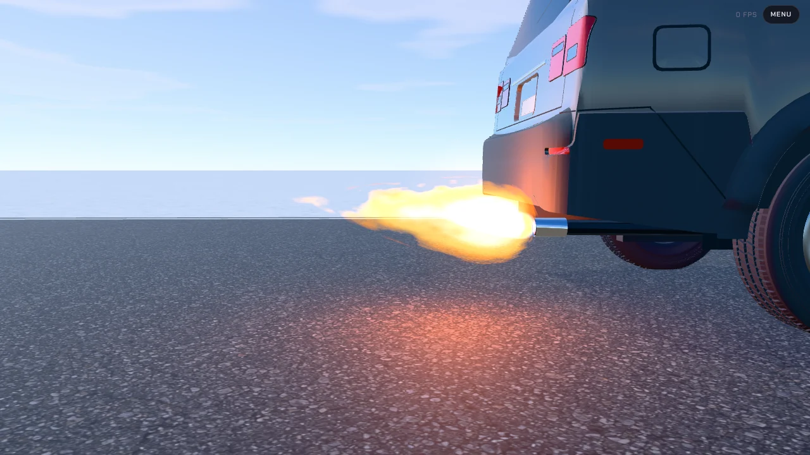

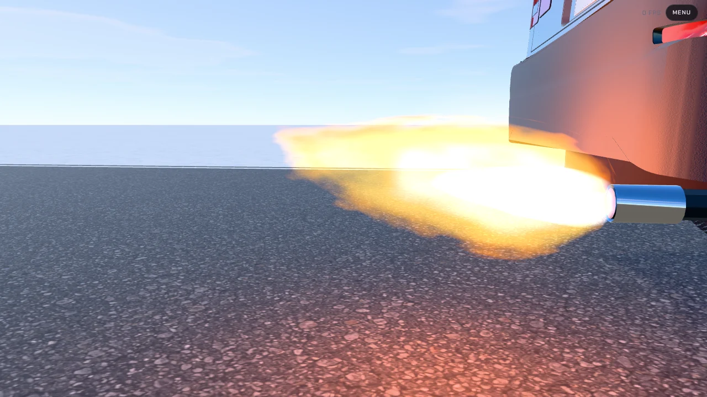

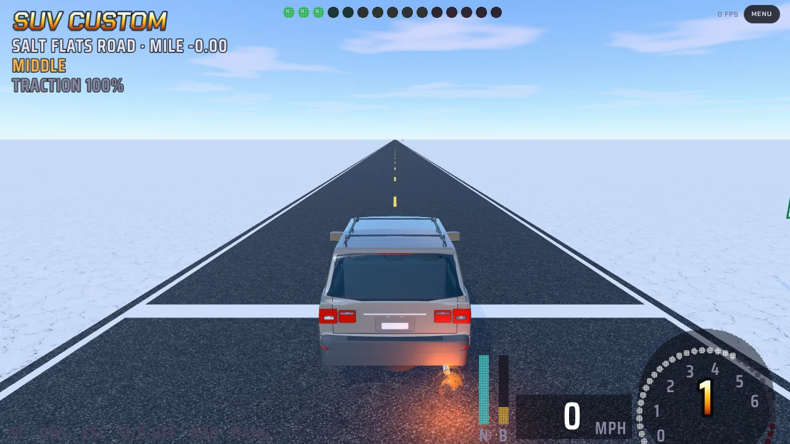

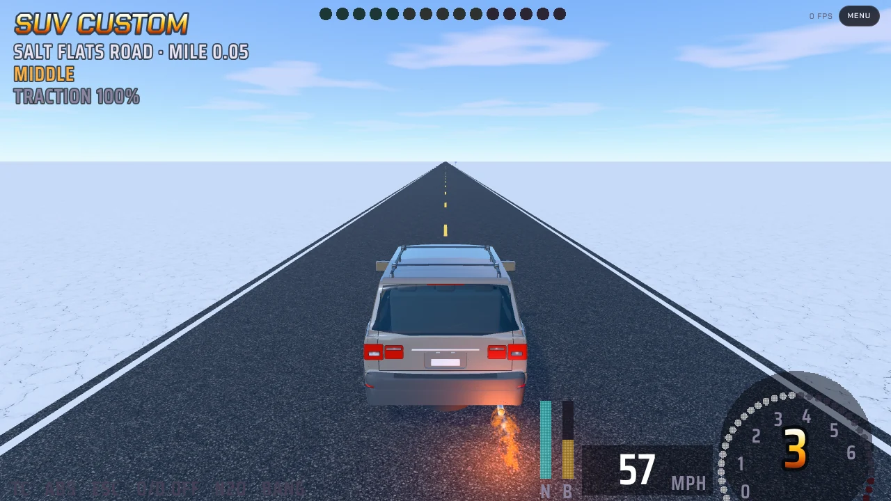

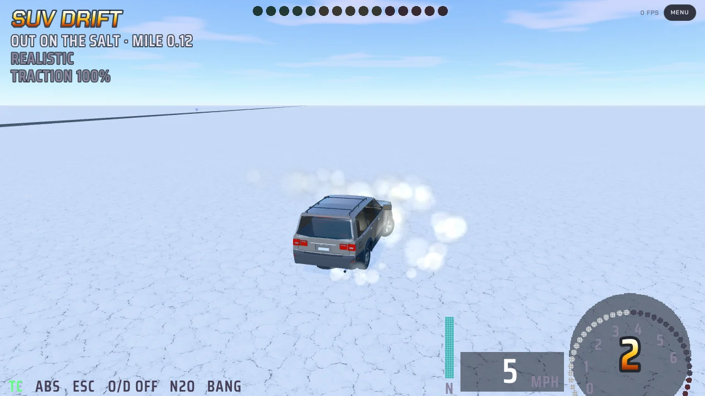

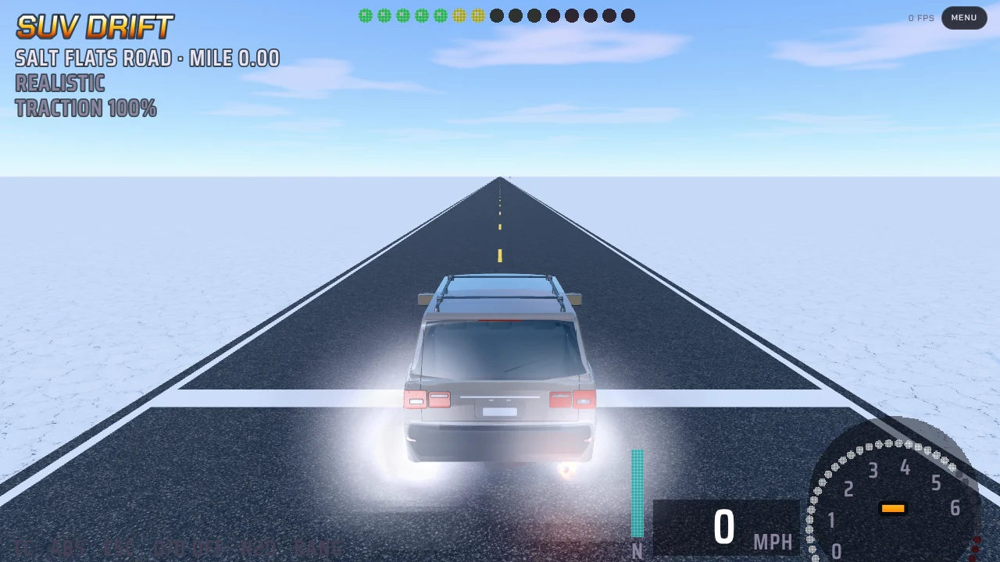

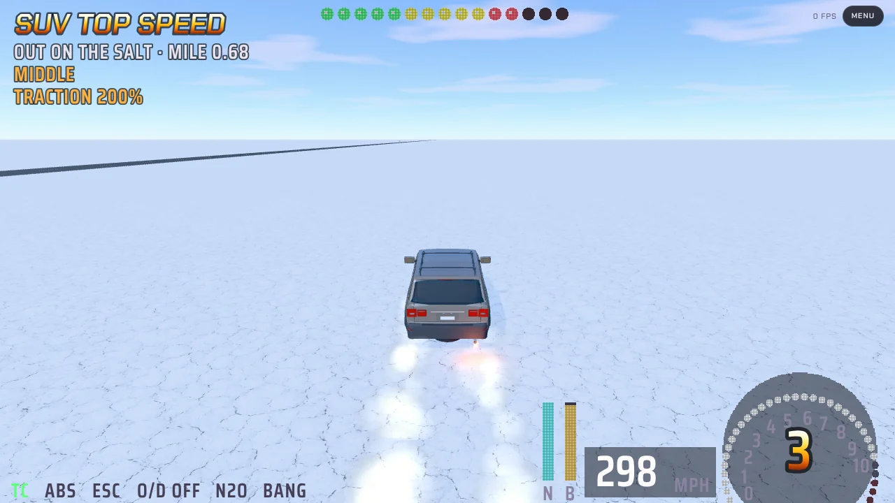

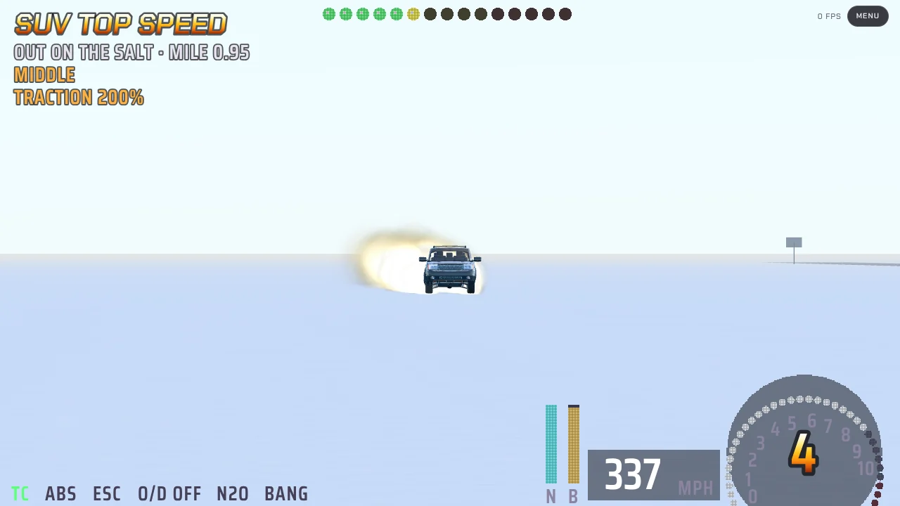

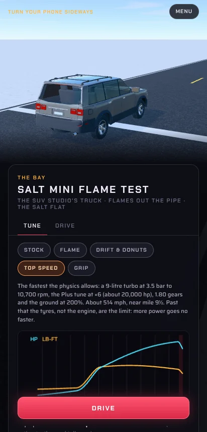

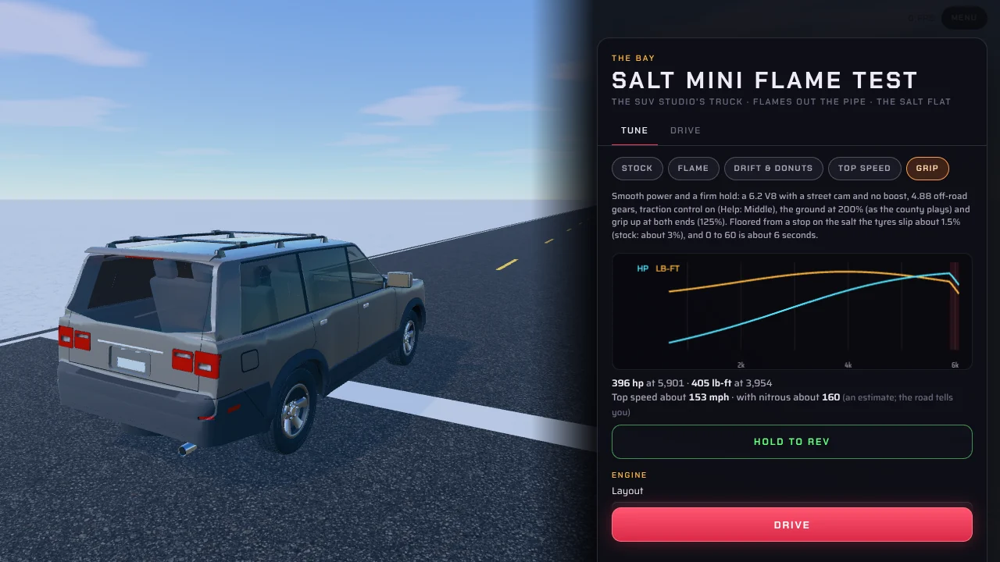

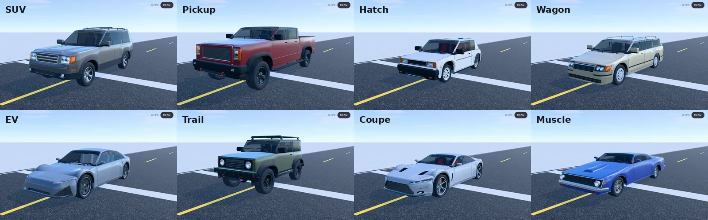

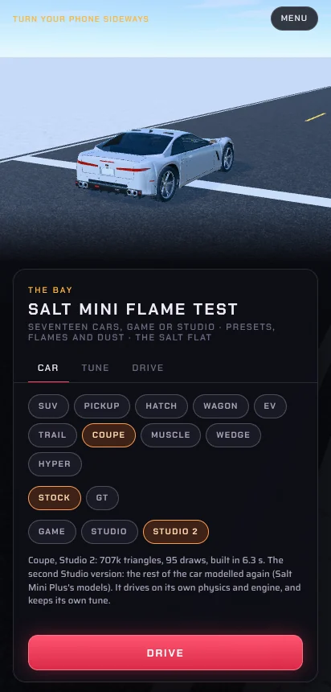

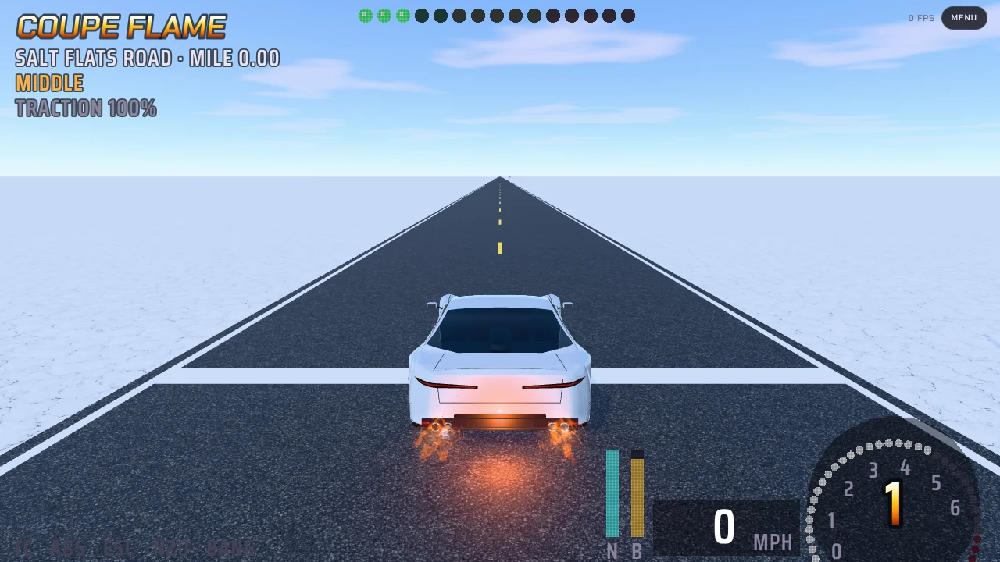

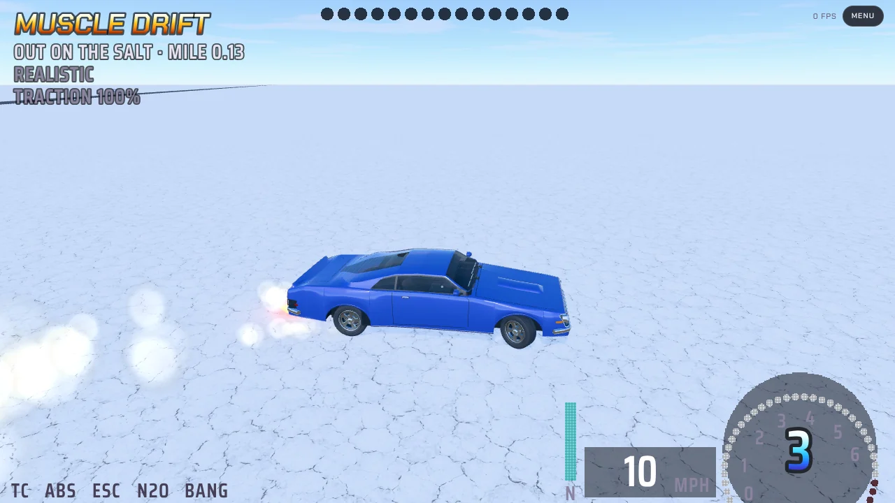

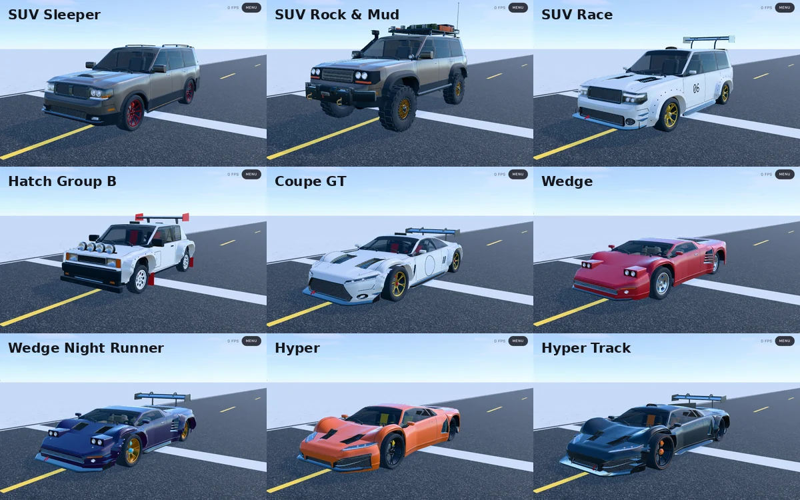

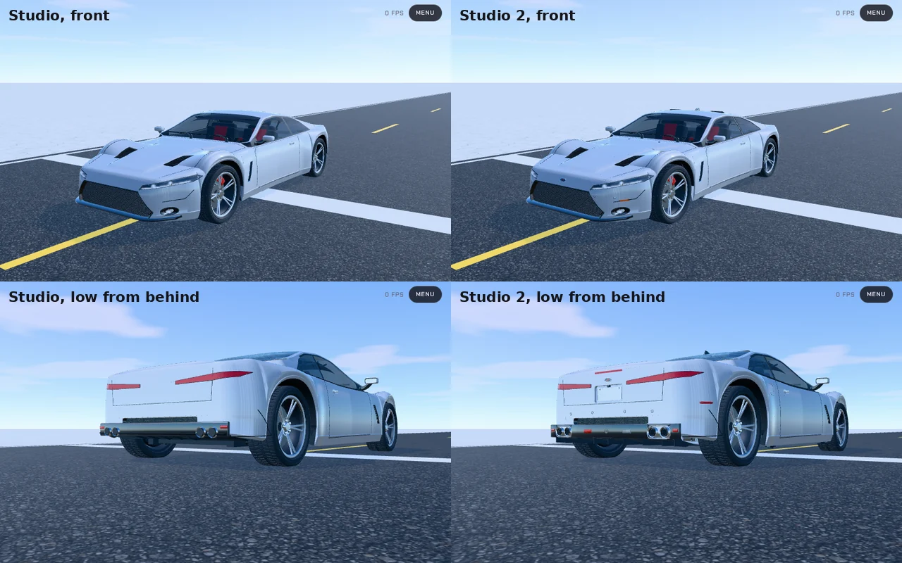

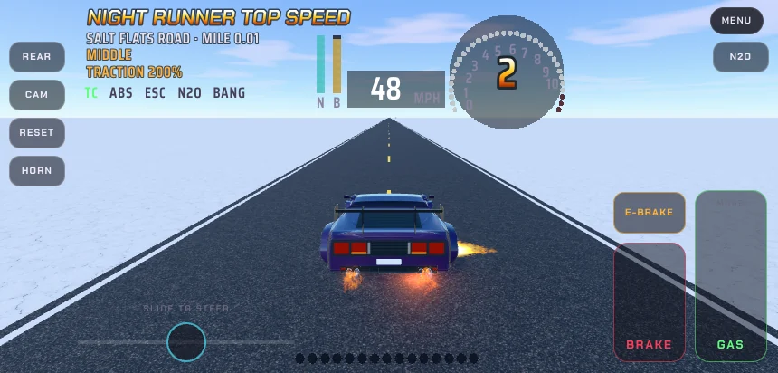
